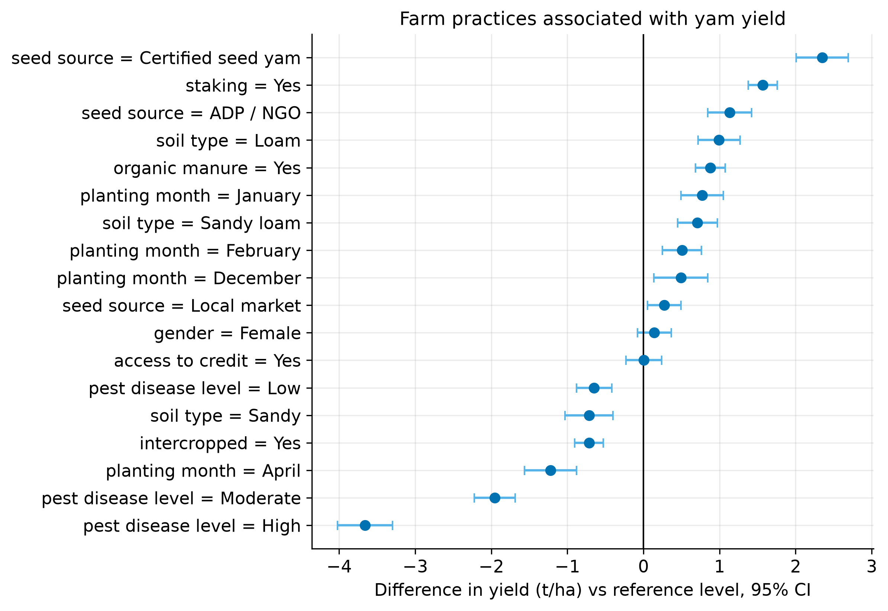
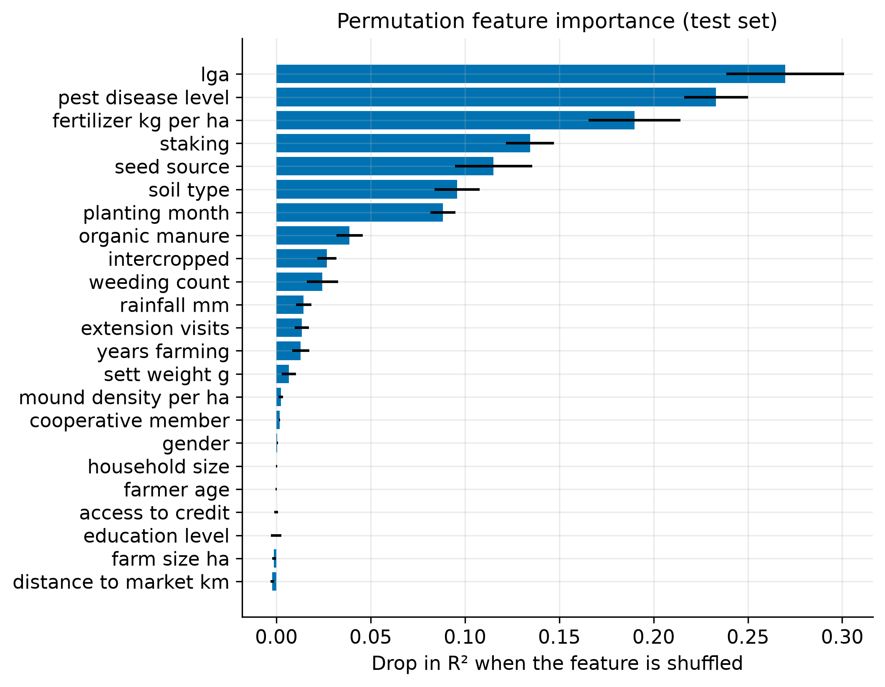

# Farm practices associated with yam yield in Nasarawa State: a reproducible data science analysis

**Group 04** · NSUK Python for Data Science Workshop 2026 · Group project

**Authors:** *Ladipo Oluyomi, Gideon Ekwaji, Monday John and Onyekachi Isaac Okogbue, Emeka Onyekwelu, Irene Abah*

> *How to use this template: replace every line in italics with your own writing, then delete the guidance. Each
> section lists who usually drafts it, but agree this in your group. Target length: **1,500–2,500 words**, plus figures
> and tables. Every number must come from your notebook. To include a figure:*
> ``

---

## Abstract *(Irene Abah, written last, ~150 words)*
*This study examined practices and farmer characteristics associated with yam yield in Nasarawa State using a synthetic survey dataset. After cleaning, 2,360 farms across 13 Local Government Areas were analzyed. Methods included descriptive statistics, Welch’s t-tests, a chi-square test, multiple linear regression and machine-learning comparison. Staked farms had a higher mean yield than non-staked farms (10.46 versus 8.83 t/ha; difference = 1.63 t/ha, 95% CI [1.40, 1.85], p < 0.001). Cooperative membership was associated with credit access (χ²(1) = 205.63, p < 0.001; Cramér’s V = 0.30). In multiple regression, staking remained positively associated with yield (coefficient = 1.57 t/ha; 95% CI [1.38, 1.76]), based on 1,846 complete cases. Linear regression was the best-performing predictive model, achieving test R² = 0.586 and MAE = 1.424 t/ha. These findings illustrate associations and predictive performance within simulated data; they do not establish causal effects or provide empirical evidence about actual farms.*

## 1. Introduction and research question *(Member 5 or Coordinator)*
*Why does yam yield matter in Nasarawa State (food security, income)? State the research question and hypotheses H1–H3 from Part 4.1 of the notebook. Say clearly that the data is synthetic and for teaching.*

## 2. Data and cleaning *(Member 1)*
### 2.1 The dataset
*Describe the survey: number of rows and columns, what one row represents, the outcome variable and its unit, and the main groups of variables (farmer, practices, environment, outcomes). Refer to `data/README.md`.*

### 2.2 Data-quality problems and how we fixed them
*Paste and complete your audit table from Part 1.9: problem → columns → how many rows → fix. Then give the final number of farms after cleaning and explain why missing values were **not** filled in at this stage.*

| Problem | Columns | Rows affected | Fix |
|---|---|---|---|
| | | | |

### 2.3 Leaky variables
*Which two columns were excluded from prediction, and why?*

## 3. Exploratory analysis *(Member 2)*
*Describe the distribution of yield (mean, SD, range) and your 3–5 key findings from Part 3, each with a number. Include at least one figure. Discuss the curved rainfall relationship and what the gender comparison tables showed.*

## 4. Hypothesis tests *(Member 3)*
*Report H1 (staking, Welch's t-test), H2 (cooperative × credit, chi-square) and H3 (gender, t-test) in APA style with effect sizes and confidence intervals. Example:*
> *Farms that staked their vines had a higher mean yield than farms that did not (difference = __ t/ha, 95% CI [__, __]), Welch's t = __, p < .001, Cohen's d = __.*

*Include Table 1 (descriptive statistics by staking).*

## 5. Regression analysis *(Member 3)*
*Which variables were in the model, how many rows were used (and why fewer than the cleaned total), and the adjusted R². Interpret the 4–6 most important coefficients with their 95% CIs (direction, size, unit). Explain what the squared terms show. **Discuss the gender gap:** raw difference vs adjusted difference, and what this suggests. Include Figure 2 (coefficient plot). Mention the assumption checks.*

## 6. Predicting yield with machine learning *(Member 4)*
*Features used, train/test split, the four models compared (include Table 3 from `results/table3_model_comparison_cv.csv`), which model was chosen and why, and the test-set R², MAE and RMSE in plain words ("predictions are typically within about __ t/ha"). Explain the leakage experiment in your own words. Include Figures 3 and 4 and comment on feature importance (and why importance ≠ causation).*

## 7. The Streamlit app *(Member 5)*
*The streamlit web application here was used to demonstrate the use of machine learning in predicting yam yield based on farm and farmer characteristics. It uses the trained regression model to generate estimated yam yield in tonnes per hectare (t/ha) from user-provided farm information.The application is intended for yam farmers, agricultural extension officers, data scientists, researchers, students and agricultural development organisations interested in exploring data-driven approaches to agricultural productivity.
Limitations: The model uses synthetic data rather than actual farmer records. Predictions are most reliable within the ranges and categories represented in the training data. Furthermore, the model identifies statistical patterns and associations; it does not establish causal relationships. Its test R² of 0.586 and MAE of 1.424 t/ha also indicate prediction errors.*

## 8. Discussion and limitations *(everyone)*
*What do the results mean together? Which practices seem most promising for farmers or extension officers? Limitations: synthetic data; observational (association, not causation); missing data and listwise deletion in the regression; possible unmeasured confounders; model only valid for farms similar to the training data.*

## 9. Conclusion *(Member 5)*
*3–5 sentences answering the research question.*

## 10. What we learned as a team *(everyone, ~1 short paragraph each, optional but encouraged)*
*What was hard, what you would do differently, and how you used Git and GitHub together.*

---

## References
*Only cite sources you have actually read. Check every reference exists, because AI tools invent references. If you cite nothing, delete this section.*

## Appendix: reproducibility
- Repository: *link*
- Run: `pip install -r requirements.txt` → open `notebooks/group_project.ipynb` → **Run All** → `streamlit run app/streamlit_app.py`
- AI use: see [`docs/AI_USE_STATEMENT.md`](../docs/AI_USE_STATEMENT.md)
- Contributions: see [`CONTRIBUTIONS.md`](../CONTRIBUTIONS.md)
