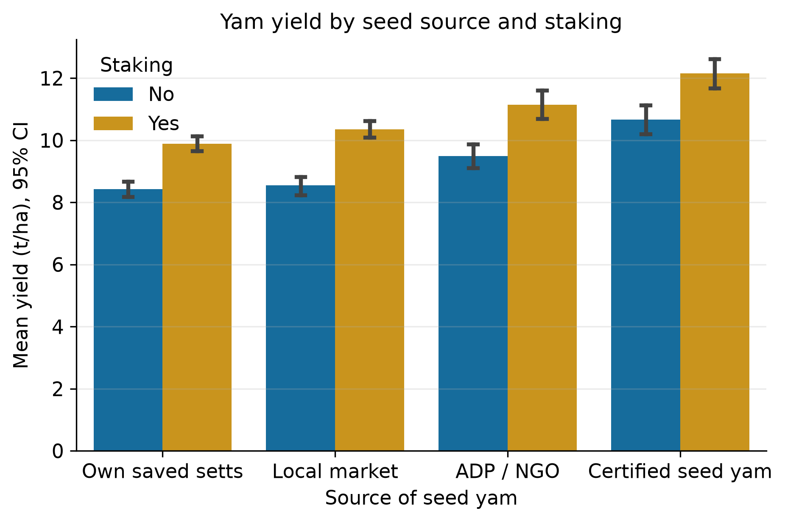
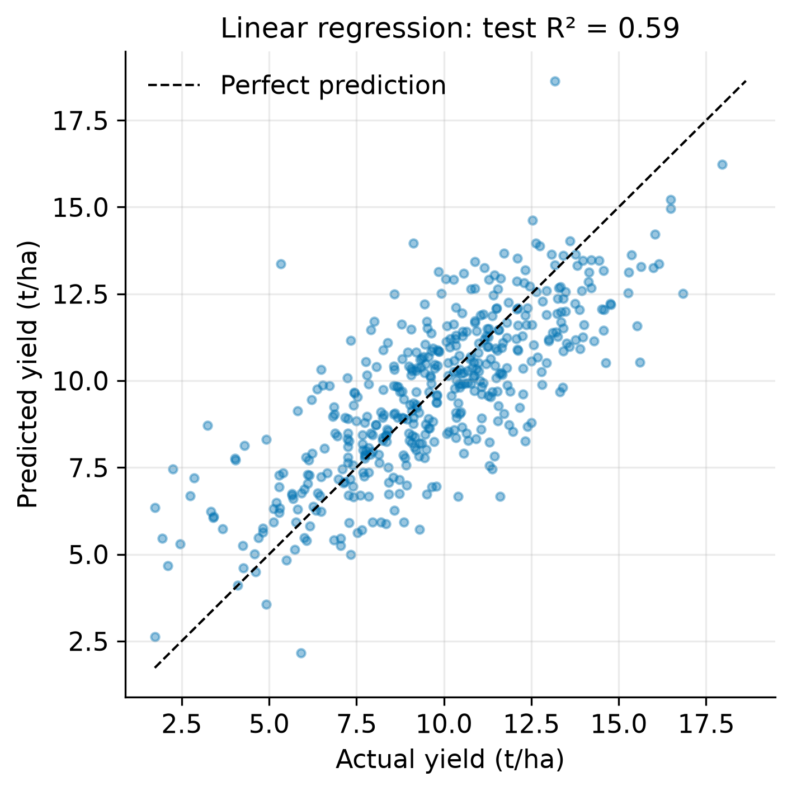

# Farm practices associated with yam yield in Nasarawa State: a reproducible data science analysis

**Group 04** · NSUK Python for Data Science Workshop 2026 · 

**Authors:** *Ladipo Oluyomi, Gideon Ekwaji, Monday John and Onyekachi Isaac Okogbue, Emeka Onyekwelu, Irene Abah*

> *How to use this template: replace every line in italics with your own writing, then delete the guidance. Each
> section lists who usually drafts it, but agree this in your group. Target length: **1,500–2,500 words**, plus figures
> and tables. Every number must come from your notebook. To include a figure:*
> ``

---

**Authors:** Ladipo Oluyomi, Gideon Ekwajiayo, Monday John, Onyekachi Isaac Okogbue, Emeka Joseph Onyekwelu, Irene Abah

---

## Abstract
Yam is a major food and cash crop in Nasarawa State, yet yields vary widely between farms. We asked which farm practices are linked with higher yam yield, using a synthetic teaching survey of 2,436 farm records across all 13 LGAs. After cleaning, 2,360 farms remained. We used Welch's t-tests, a chi-square test, a one-way ANOVA, multiple regression and machine learning. Staked farms yielded 1.63 t/ha more than unstaked farms (Cohen's d = 0.58), and the effect held in the regression (1.57 t/ha) after controlling for other factors. Certified seed yam was linked with 2.35 t/ha more than own saved setts, while high pest and disease pressure was linked with 3.66 t/ha less. The small gender gap in yield (0.33 t/ha) was no longer significant once practices and resources were taken into account. A linear regression model predicted yield on unseen farms with a typical error of about 1.4 t/ha (test R² = 0.59). Staking, better seed and pest control look like the most promising practices to promote.

## 1. Introduction and research question
Yam is central to food security and household income in Nasarawa State, and the state is one of Nigeria's main yam-producing areas. Two farmers in the same area can get very different harvests, and much of that difference comes from how the crop is managed. Knowing which practices matter most helps farmers and extension officers decide where to put their limited time and money.

Our research question was: **which farm practices are associated with higher yam yield among smallholder farmers in Nasarawa State?**

We tested three hypotheses:

- **H1:** Farms that stake their yam vines have a higher mean yield than farms that do not.
- **H2:** Cooperative members are more likely to have access to credit.
- **H3:** Mean yield differs between male and female farmers.

The data used here is synthetic. It was simulated for teaching and loosely based on yam agronomy, so the results show how the methods work and must not be cited as evidence about real farms.

## 2. Data and cleaning
### 2.1 The dataset
The raw file has 2,436 rows and 28 columns. Each row is one farm in one survey season (2021 to 2025). The outcome is yam yield in tonnes per hectare (`yield_t_per_ha`). The other columns fall into four groups:

- **Farmer:** age, gender, education, household size, years of farming, cooperative membership, access to credit.
- **Practices:** seed source, sett weight, mound density, planting month, staking, fertiliser, organic manure, intercropping, weeding, extension visits.
- **Environment:** LGA, soil type, rainfall, pest and disease level, distance to market.
- **Outcomes:** yield, tubers harvested and harvest revenue.

Full definitions are in `data/README.md`.

### 2.2 Data-quality problems and how we fixed them
We audited the raw data before changing anything (Part 1), then fixed each problem in code (Part 2), so every step can be repeated.

| Problem | Columns | Rows affected | Fix |
|---|---|---|---|
| Duplicate rows | all | 36 | Dropped them |
| Inconsistent spelling and stray spaces | lga | 49 spellings of 13 LGAs | Removed spaces, fixed capitals, mapped variants such as N/Eggon and Nassarawa |
| Yes/No written many ways | staking, organic_manure, intercropped, cooperative_member, access_to_credit | About 10 versions in each column | Mapped to Yes and No |
| Male/Female written many ways | gender | 8 versions | Mapped to Male and Female |
| Planting month written many ways | planting_month | 25 versions of 5 months | Mapped to full month names |
| Text in number columns | fertilizer_kg_per_ha, harvest_revenue_naira | 73 and 612 | "not recorded", "-" and "nil" set to missing; ₦, N and commas removed from revenue |
| Missing-value code | rainfall_mm | 28 coded -999 | Set to missing |
| Impossible values | farmer_age, farm_size_ha, mound_density_per_ha, yield_t_per_ha | 14, 9, 7 and 4 | Values outside a valid range set to missing |
| No outcome | yield_t_per_ha | Rows with missing yield | Dropped |

After cleaning, **2,360 farms** remained, with 13 LGAs, 2 gender values and 5 planting months. The clean data is saved as `data/processed/yam_survey_clean.csv`.

We did not fill in the remaining missing values at this stage. Filling them using the whole dataset would let information from the test set leak into the model. Instead, the machine-learning pipeline fills them in Part 6 using the training data only.

### 2.3 Leaky variables
Two columns were left out of prediction: `harvest_revenue_naira` and `tubers_harvested_per_ha`. Both are only known after harvest, and revenue is calculated from yield itself. Using them to predict yield would be cheating, because a farmer would not have them before the season ends.

## 3. Exploratory analysis
Across the 2,360 farms, mean yield was 9.64 t/ha (SD 2.94), ranging from 1.50 to 18.70 t/ha, with a median of 9.71 t/ha. The distribution was roughly symmetric, so the mean and median tell a similar story.

Key findings:

- **Yield varies a lot by LGA.** Akwanga (11.10 t/ha), Toto (11.00) and Wamba (10.92) had the highest mean yields, while Kokona (7.94) and Keffi (7.95) had the lowest, a gap of about 3 t/ha.
- **Staked farms did better.** Mean yield was 10.46 t/ha for staked farms against 8.83 t/ha for unstaked farms.
- **Seed source matters.** Farms using certified seed yam averaged 11.46 t/ha, against 9.12 t/ha for own saved setts. Yet only 236 farms used certified seed, while 1,046 used their own setts.
- **Male and female farmers differ in resources, not just yield.** Women had a slightly lower mean yield (9.40 vs 9.73 t/ha), but they also had fewer extension visits (0.80 vs 1.53), smaller farms (1.13 vs 1.52 ha), less access to credit (13.9% vs 29.0%) and staked less often (35.1% vs 55.4%). These differences could explain the yield gap without gender itself being the cause, which we tested in Section 5.
- **Rainfall has a curved relationship with yield.** Yield rises with rainfall up to a point and then falls, which is why we later added a squared rainfall term to the regression.

## 4. Hypothesis tests
**H1 (staking).** Farms that staked their vines (n = 1,174) had a higher mean yield than farms that did not (n = 1,186), with a difference of 1.63 t/ha, 95% CI [1.40, 1.85], Welch's t = 13.99, p < .001, Cohen's d = 0.58. This is a medium effect, so H1 is supported.

**H2 (cooperative membership and credit).** 40.8% of cooperative members had access to credit, compared with 14.6% of non-members, χ²(1) = 205.63, p < .001, Cramér's V = 0.30. This is a moderate association, so H2 is supported. It shows the two go together, not that joining a cooperative causes access to credit.

**H3 (gender).** Male farmers had a mean yield of 9.73 t/ha and female farmers 9.40 t/ha, a difference of 0.33 t/ha, Welch's t = 2.47, p = .014. The difference is statistically significant but small. With over 2,000 farms, even small differences can reach significance, so we looked at it again in the regression.

We also compared the four seed sources with a one-way ANOVA, F = 49.86, p < .001. Mean yield rose steadily from own saved setts (9.12 t/ha) to local market (9.50), ADP/NGO (10.27) and certified seed yam (11.46).

**Table 1.** Descriptive statistics by staking (`results/table1_descriptives_by_staking.csv`)

| Variable | Not staked: mean (SD) | Staked: mean (SD) |
|---|---|---|
| Yield (t/ha) | 8.83 (2.84) | 10.46 (2.81) |
| Fertiliser (kg/ha) | 108.84 (86.26) | 109.46 (90.64) |
| Farm size (ha) | 1.43 (1.84) | 1.40 (0.94) |
| Weeding count | 2.48 (0.86) | 2.48 (0.86) |
| Extension visits | 1.11 (1.28) | 1.55 (1.48) |

Staked and unstaked farms were almost identical on fertiliser, farm size and weeding. The one clear difference was extension visits, which is why the regression, which holds extension visits constant, is a fairer test of staking.

## 5. Regression analysis
We fitted a multiple regression of yield on fertiliser, rainfall, mound density, sett weight, weeding count, extension visits, staking, organic manure, intercropping, planting month, soil type, access to credit, seed source, pest and disease level, and gender. The model used 1,846 of the 2,360 farms, because rows with a missing value in any of these columns are dropped. The model had an adjusted R² of 0.523, meaning it explains about half of the variation in yield.

Holding the other factors constant, the most important results were (full table in `results/table2_regression_coefficients.csv`):

- **Pest and disease pressure** had the largest effect. Compared with farms where pests were absent, yield was 3.66 t/ha lower at a high level (95% CI [-4.02, -3.30]) and 1.96 t/ha lower at a moderate level.
- **Certified seed yam** was linked with 2.35 t/ha more than own saved setts (95% CI [2.01, 2.69]), and ADP/NGO seed with 1.13 t/ha more.
- **Staking** added 1.57 t/ha (95% CI [1.38, 1.76]), close to the raw t-test difference.
- **Planting in April** was linked with 1.22 t/ha less than planting in March, while planting from December to February was linked with higher yields.
- **Organic manure** added 0.88 t/ha, while **intercropping** was linked with 0.72 t/ha less.
- **Fertiliser** added about 0.11 t/ha for every extra 10 kg/ha, and each extra weeding added 0.37 t/ha.
- **Access to credit** had no effect once everything else was included (p = .97).

We checked the residuals vs fitted plot and the Q-Q plot (Part 5.3). Because the exploratory analysis suggested curved effects, we added squared terms for rainfall and mound density. This raised the adjusted R² from 0.523 to 0.599, showing that both have a "best middle value": too little or too much rainfall, and too few or too many mounds, are both linked with lower yield.

**The gender gap.** The raw t-test showed female farmers yielding 0.33 t/ha less than men (p = .014). In the regression with squared terms, which compares farmers with the same practices and conditions, the adjusted gap was 0.20 t/ha in favour of women, 95% CI [-0.01, 0.40], p = .059, which is not significant. In this dataset, the lower raw yield of women is explained by differences in practices and resources, such as staking, extension visits and credit, rather than by gender itself. This suggests that support aimed at women farmers, such as extension visits and staking materials, could close the gap.

## 6. Predicting yield with machine learning
We used 23 features, leaving out the two leaky columns, the farm ID and the outcome. We first locked away 20% of the farms as a test set (1,888 training farms, 472 test farms). Missing values were filled, numbers were scaled and categories were one-hot encoded inside a pipeline fitted on the training data only.

We compared four models with 5-fold cross-validation on the training data.

**Table 3.** Model comparison with 5-fold cross-validation (`results/table3_model_comparison_cv.csv`)

| Model | R² (mean) | R² (SD) | MAE (t/ha) |
|---|---|---|---|
| Baseline (predict the mean) | -0.002 | 0.002 | 2.378 |
| Linear regression | 0.629 | 0.023 | 1.426 |
| Random forest | 0.468 | 0.019 | 1.705 |
| Gradient boosting | 0.623 | 0.015 | 1.439 |

Linear regression did best, slightly ahead of gradient boosting, and it is also the easiest to explain, so we chose it. On the test set it reached R² = 0.586, MAE = 1.42 t/ha and RMSE = 1.83 t/ha. In plain words, its predictions are typically within about 1.4 t/ha of the real yield, compared with about 2.4 t/ha if we simply guessed the average.

**Leakage experiment.** When we added `tubers_harvested_per_ha` back in, R² jumped from 0.623 to 0.873. That looks impressive, but it is false: the number of tubers is only known after harvest and is almost a direct measure of yield. A model like that would be useless to a farmer planning the season, which is why we left it out.

**Feature importance.** Shuffling LGA, pest and disease level, fertiliser, staking and seed source caused the largest drops in R², so these carry most of the predictive information. Gender, access to credit, farm size and distance to market added almost nothing. Importance shows what helps the model predict, not what causes high yield. LGA ranks first, for example, because it stands in for many local conditions at once.

## 7. The Streamlit app *(Irene Abah)*
*The streamlit web application here was used to demonstrate the use of machine learning in predicting yam yield based on farm and farmer characteristics. It uses the trained regression model to generate estimated yam yield in tonnes per hectare (t/ha) from user-provided farm information.The application is intended for yam farmers, agricultural extension officers, data scientists, researchers, students and agricultural development organisations interested in exploring data-driven approaches to agricultural productivity.
Limitations: The model uses synthetic data rather than actual farmer records. Predictions are most reliable within the ranges and categories represented in the training data. Furthermore, the model identifies statistical patterns and associations; it does not establish causal relationships. Its test R² of 0.586 and MAE of 1.424 t/ha also indicate prediction errors.*

## 8. Discussion and limitations
Taken together, the results point to three practices that farmers and extension officers could focus on: **staking**, **better seed** (certified or ADP/NGO seed yam), and **pest and disease control**. Each was linked with a gain of more than 1.5 t/ha after controlling for other factors, which is a large share of an average yield of about 9.6 t/ha. Planting earlier (December to March rather than April) and using organic manure also look helpful. The gender analysis shows that women's lower yields are linked with less access to practices and resources, so programmes that reach women farmers directly could make a difference.

There are important limitations:

- **The data is synthetic.** The results show how the methods work and are not evidence about real farms.
- **Association, not causation.** This is observational data. Farmers who stake may also differ in ways we did not measure, such as skill or labour.
- **Missing data.** The regression dropped 514 farms with missing values (listwise deletion), which could bias the results if those farms differ from the rest.
- **Unmeasured confounders.** Factors such as soil fertility tests, labour and yam variety are not in the data.
- **Limited range.** The model is only valid for farms similar to those in the training data.

## 9. Conclusion
In this dataset, staking, better seed and good pest and disease control are the practices most strongly linked with higher yam yield, each worth more than 1.5 t/ha. Planting time, organic manure and intercropping also matter. The small gender gap in yield disappears once practices and resources are taken into account, which points to access to support rather than gender itself. A simple linear regression model can predict yield on new farms to within about 1.4 t/ha.

## 10. What we learned as a team
*(Optional: each member can add a short paragraph on what was hard, what they would do differently, and how we used GitHub together.)*

---

## Appendix: reproducibility
- Repository: https://github.com/YommYuk/nsuk-ds-group-04
- Run: `pip install -r requirements.txt` → open `notebooks/group_project.ipynb` → **Run All** → `streamlit run app/streamlit_app.py`
- AI use: see [`docs/AI_USE_STATEMENT.md`](../docs/AI_USE_STATEMENT.md)
- Contributions: see [`CONTRIBUTIONS.md`](../CONTRIBUTIONS.md)
